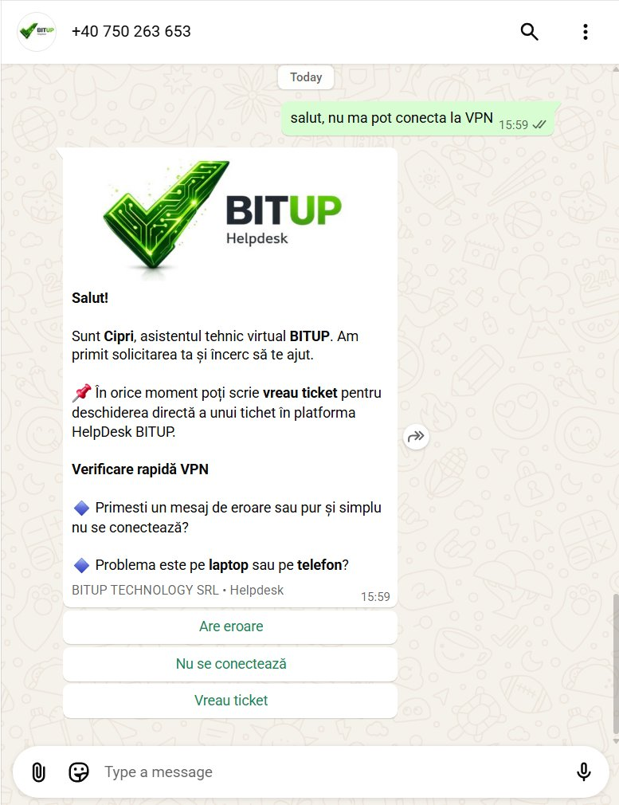
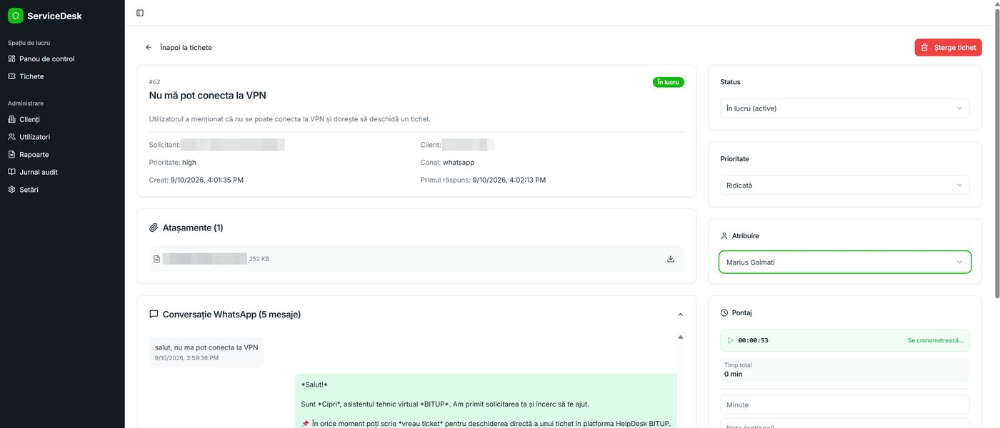

Orice patron cu care am vorbit în ultimii ani mi-a pus, într-o formă sau alta, aceeași întrebare: „și când am o problemă, unde ajunge? Cine răspunde?” E o întrebare bună. Într-o firmă mică, suportul IT arată de obicei așa: un telefon pe care îl suni și speri să răspundă cineva, un email trimis marți și uitat până joi, un post-it lipit pe monitor cu „de spus lui X”. Nimeni nu știe câte probleme au fost luna trecută, cât a durat fiecare, ce s-a rezolvat și ce a rămas în aer.

Am vrut ca la BitUp răspunsul la întrebarea asta să fie unul singur și scurt. Așa că am construit sistemul care îl dă.

## De ce n-am cumpărat unul

Am încercat. Sistemele de tichete de pe piață sunt bune, dar sunt făcute pentru corporații: un portal în care angajatul trebuie să-și facă cont și să-și amintească parola, un formular cu zece câmpuri pentru „nu-mi merge imprimanta”, licențe per agent, și o listă de funcții din care o firmă de 30 de oameni folosește trei.

Eu voiam trei lucruri, și le voiam împreună. Un canal pe care oamenii îl folosesc deja, fără cont și fără aplicație nouă. Un prim răspuns pe loc, la orice oră, nu „vă vom contacta în cel mai scurt timp”. Și o urmă scrisă pentru fiecare cerere, ca la sfârșitul lunii să pot spune clientului exact ce s-a întâmplat, nu din memorie.

Canalul era evident: WhatsApp. Angajații clienților mei sunt deja acolo toată ziua. Restul l-am construit.

## Cum arată azi o cerere de suport

Uite o cerere reală, de la primul mesaj până la raport. Am ascuns numele clientului și numerele de telefon.

**1. Scrii pe WhatsApp.** Un angajat scrie pe numărul de suport BitUp, cu cuvintele lui: „salut, nu mă pot conecta la VPN”. Atât. Fără cont, fără formular, fără să știe ce e un tichet.

**2. Cipri te recunoaște.** Cipri e asistentul nostru virtual. Identifică firma după numărul de telefon și răspunde în câteva secunde. Nu cu un paragraf, ci cu întrebările care contează pentru problema respectivă și cu butoane: „Are eroare”, „Nu se conectează”, „Vreau ticket”.

**3. Preia tot ce contează.** Capturi de ecran, mesaje de eroare, detalii. Pentru problemele frecvente propune pași de rezolvare; dacă se rezolvă din pași, se închide acolo și nimeni nu mai e deranjat. Oricând, „vreau ticket” sare direct la pasul următor.

**4. Deschide singur tichetul.** Când problema nu se rezolvă din pași, Cipri creează tichetul în BitUp Helpdesk cu tot contextul: cine a scris, ce firmă, ce problemă, ce s-a încercat, atașamentele, prioritatea. Un om îl preia, cu numele lui pe tichet și cu timpul de lucru cronometrat.

**5. Afli ce s-a întâmplat pe același canal.** Dacă ai scris pe WhatsApp, statusul vine pe WhatsApp. Dacă ai deschis tichetul din formularul de pe helpdesk.bitup.ro, vine pe email. Iar la sfârșitul lunii, firma primește raportul cu toată activitatea ei: ce s-a cerut, ce s-a rezolvat, cât a durat, ce a rămas deschis. Raportul se generează din tichete. Nu-l scrie nimeni din memorie.

## Ce face AI-ul și ce nu face

Pentru că lucrez în securitate, știu ce întrebare urmează, așa că răspund înainte să fie pusă.

Cipri rulează pe WhatsApp Business API, cu un model de limbaj în spate (ChatGPT). Ce face: primul răspuns imediat, clarificarea problemei, pași de rezolvare pentru situațiile frecvente, preluarea atașamentelor și deschiderea tichetului cu tot contextul.

Ce nu face: nu intră în sistemele clientului, nu schimbă parole, nu execută comenzi și nu decide singur că o problemă e închisă dacă omul spune că nu e. Tot ce nu se rezolvă din pași ajunge la un om.

Datele: conversațiile și tichetele stau în platforma BitUp, izolate per client în baza de date. O firmă nu vede și nu poate atinge nimic din altă firmă. Asistentul primește doar contextul cererii curente, nu acces la infrastructura nimănui.

## Ce am învățat construindu-l

**Primul răspuns contează mai mult decât rezolvarea rapidă.** Omul care scrie „nu-mi merge” vrea în primul rând să știe că l-a auzit cineva. Un răspuns în zece secunde, chiar dacă doar pune o întrebare, schimbă tonul întregii conversații.

**Butoanele bat paragrafele.** Prima versiune a lui Cipri scria mult. Oamenii nu citeau. Acum pune o întrebare și trei butoane.

**Dacă scrii tot, raportul lunar vine singur.** N-am construit raportul ca funcție separată. A apărut pentru că fiecare cerere, fiecare minut lucrat și fiecare rezolvare erau deja scrise undeva. Raportul e doar ce s-a întâmplat, ordonat.

**Omul rămâne acolo unde contează.** AI-ul e bun la a asculta, a întreba și a organiza. Nu e bun la a-și asuma responsabilitatea. Pe tichet e mereu un nume de om, și acela răspunde.

**Un nume contează mai mult decât credeam.** „Asistentul virtual BitUp” nu-l folosea nimeni. „Scrie-i lui Cipri” a prins din prima săptămână.

## De ce îți spun asta

Dacă ești client BitUp, asta e experiența ta de zi cu zi: nu alergi după nimeni, nimic nu se pierde, și la sfârșitul lunii știi exact pentru ce ai plătit.

Dacă nu ești, e felul în care lucrăm. Am construit fluxul pentru noi, l-am pus în producție și îl folosim zilnic înainte să-l propunem cuiva. Aceeași abordare o aducem în firma ta: procesul în cod, un om acolo unde contează, și evidență pentru tot.

Ai un proces de suport, de comenzi sau de aprobări care trăiește pe telefon și pe email? Spune-mi ce se repetă și unde se pierd lucrurile. În 30 de minute vedem dacă merită automatizat și cum. Se numește [Radiografie IT](/radiografie-it) și e gratuită.
